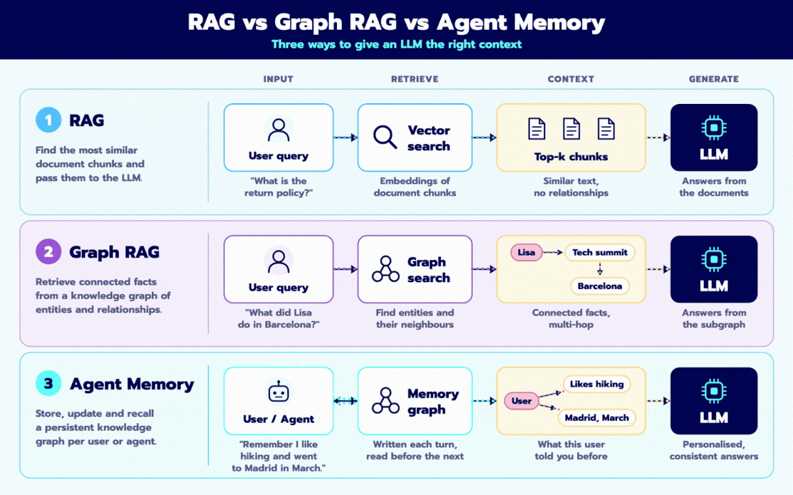

# Not every LLM context problem is a RAG problem.

There are three ways to give an LLM the right context, and they solve different problems 👇

### 1️⃣ RAG: find similar text

The query gets embedded and matched against document chunks with vector search. The top-k most similar chunks go to the LLM.

Great for: “What is the return policy?”

The limit: it retrieves similar text, not relationships. If the answer is spread across documents, similarity alone often misses it.

### 2️⃣ Graph RAG: follow connected facts

Documents are turned into a knowledge graph of entities and relationships. Retrieval finds the relevant entities and walks to their neighbours.


Great for: “What did Lisa do in Barcelona?”
→ Lisa → attended Tech Summit → held in Barcelona


The strength is multi-hop reasoning. The cost is building and maintaining the graph.

### 3️⃣ Agent Memory: remember the user

Instead of a static knowledge base, the agent keeps a persistent graph per user or agent. It’s written on each turn and read before the next one.

Great for: “Remember I like hiking and went to Madrid in March.”

This is what makes answers personalised and consistent across sessions, instead of starting from zero each time.

The key difference

RAG asks: what text is similar?
Graph RAG asks: what facts are connected?
Agent Memory asks: what did this user tell me before?

Many production systems end up combining all three. Pick based on the question you need to answer, not the trend 🎯

Which one are you building with right now? 👇


---

## 📓 Run the notebook

[`RAG_vs_GraphRAG_vs_AgentMemory.ipynb`](RAG_vs_GraphRAG_vs_AgentMemory.ipynb) builds all three on one storyline and compares them:

| Section | What it shows |
|---|---|
| 2. RAG | LangChain + Gemini embeddings; wins on single-doc lookups, misses split facts |
| 3. GraphRAG | `LLMGraphTransformer` → Neo4j, text-to-Cypher + hybrid graph retrieval; wins on multi-hop |
| 4. Agent Memory | **Graphiti (Zep)** temporal knowledge graph; facts carry `valid_at`/`invalid_at`, old facts are invalidated rather than deleted, point-in-time queries |
| 5. LangGraph agent | Combines all three; reads memory before each turn and writes it after |
| 6. Comparison | LLM-as-judge scores by question type (lookup / multi-hop / personal / temporal) |

```bash
python -m venv .venv && .venv/Scripts/activate   # Windows (use bin/activate on macOS/Linux)
pip install -r requirements.txt
cp .env.example .env                              # add GOOGLE_API_KEY + Neo4j credentials
jupyter lab RAG_vs_GraphRAG_vs_AgentMemory.ipynb
```

Requires a Gemini API key and a Neo4j database (AuraDB Free works). Groq is optional for faster answer generation.
